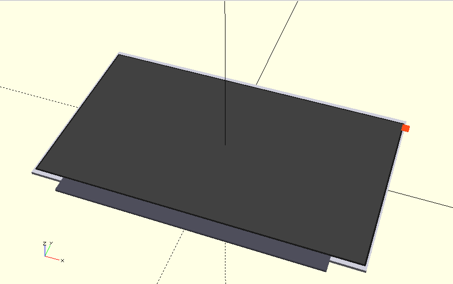
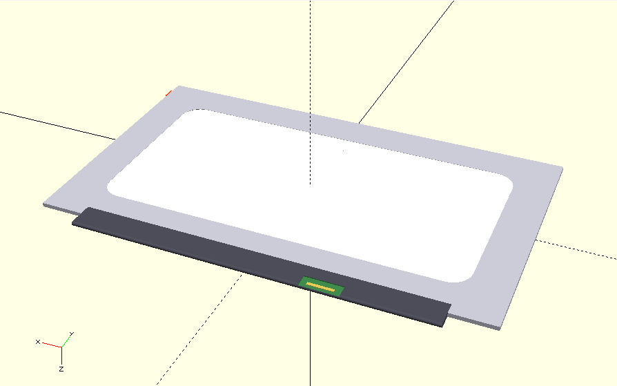
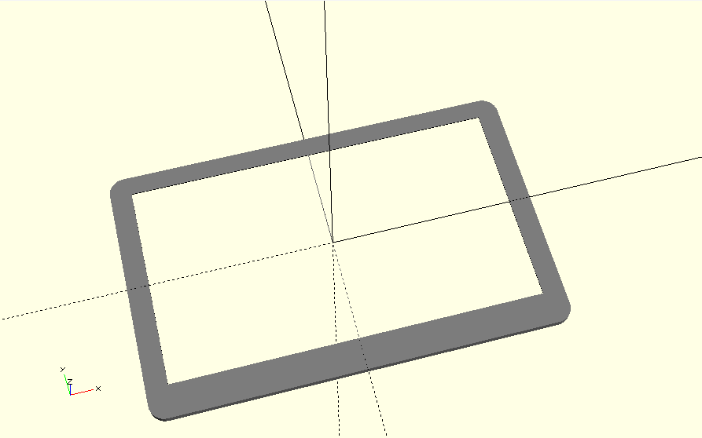
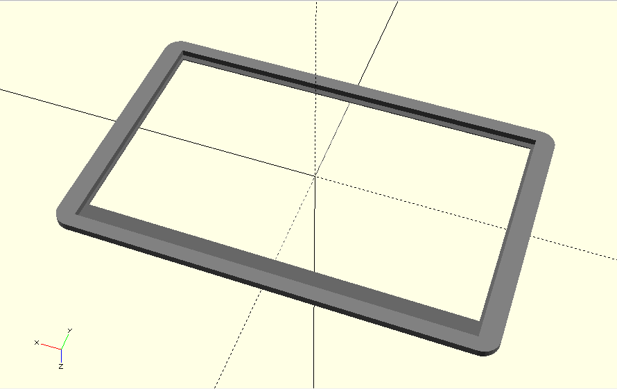
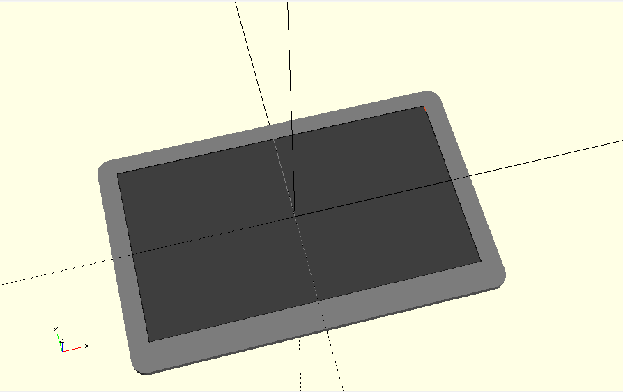
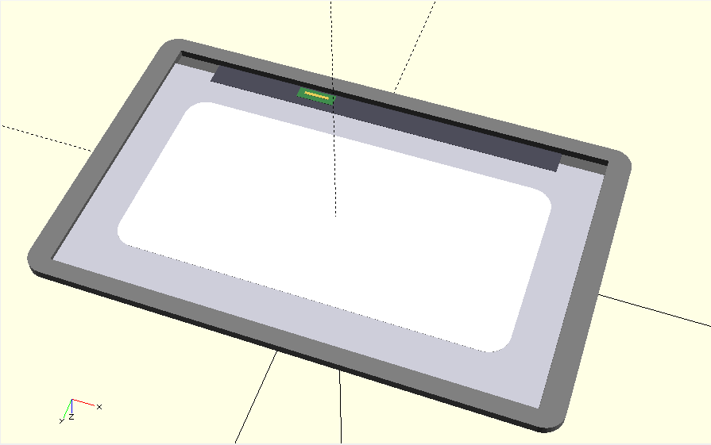

# 3D assets

## Display model

A model of a 15.6" display (accurate to the datasheet) is provided. STL file is [here](display_model.stl).  
  
</img>
</img>

## Off-the-shelf display frames

After reviewing the chinese market in detail, by contacting many suitable providers, it turned that getting a ready-made enclosure for the display (typically 15.6" as the project's main one) is extremelly difficult. All manufactures do custom runs (mostly CNC aluminium or injection plastic) but  quantities in the order of hundreds are economically not viable, at all. Their clients are tipically PC monitor manufactureres. So the current approach is to just design a model for a bezel that each user can 3D print themselves or at a 3D printing service.

see for example the not viable model tat they offer but cannot reproduce since custom designed for clients:

</img>

## Display bezel

See the custom design:  

</img>
</img>
  
With the display:  
</img>
</img>

See [STL file](display_bezel.stl)
