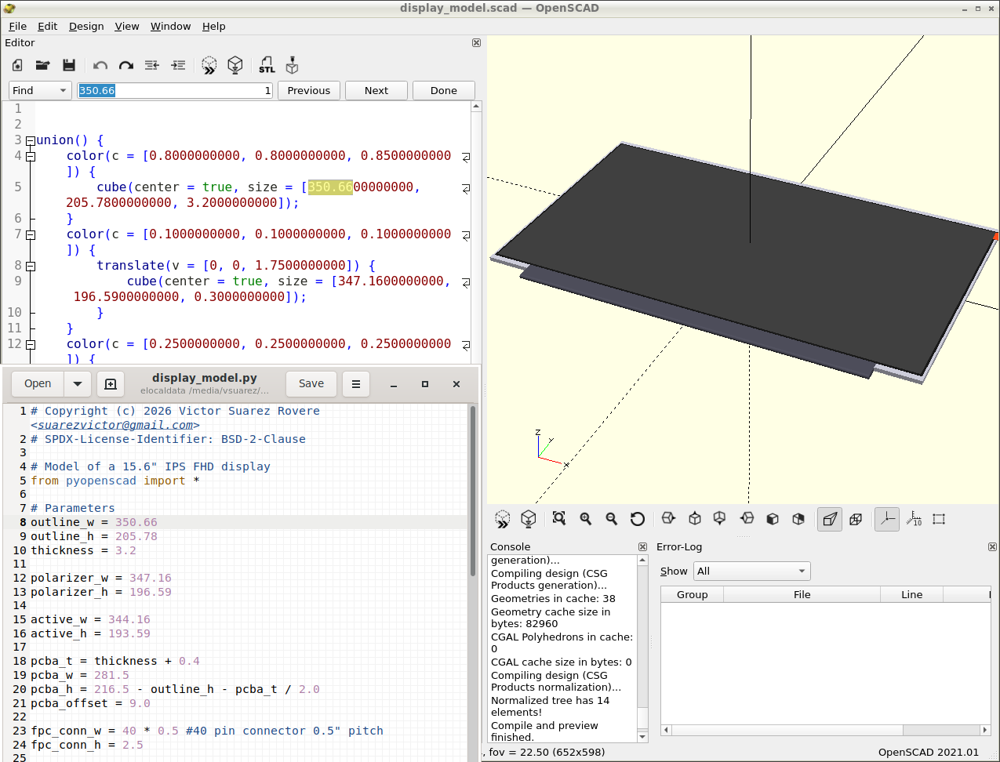
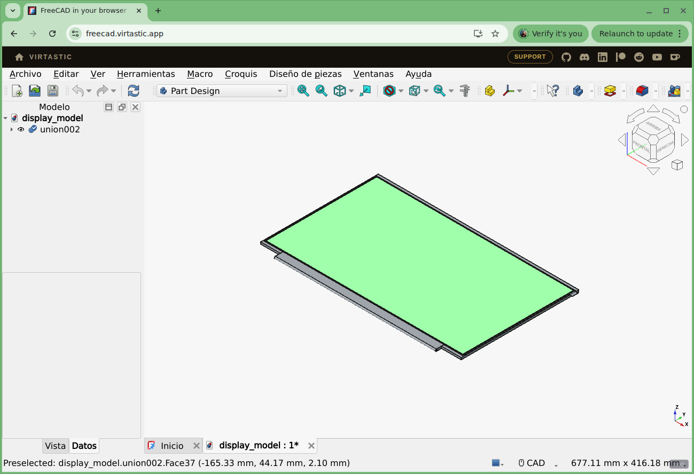
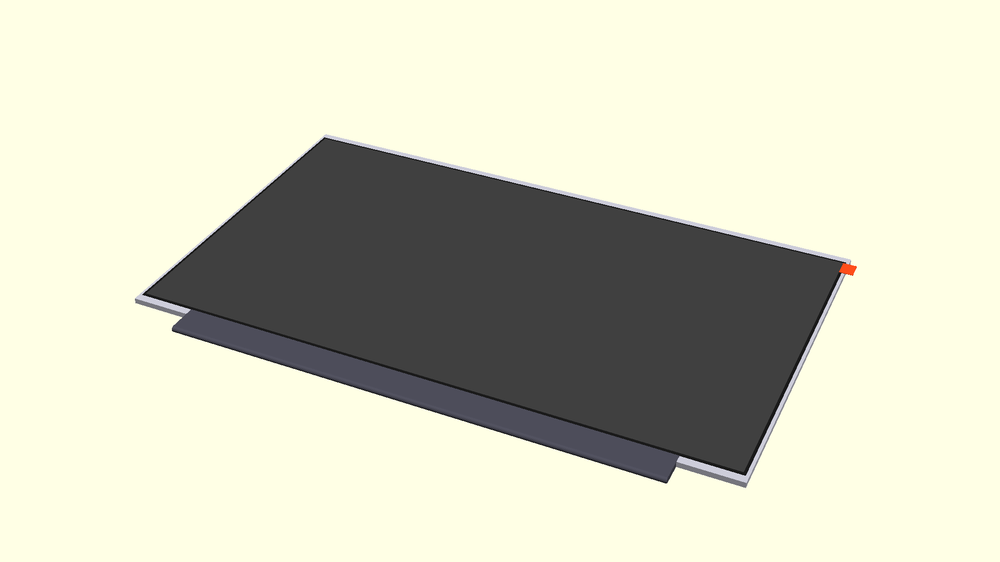

# 3D design

## Selection criteria

The criteria for the selection of a tool for the 3D design was motivated by the following constraints and associated benefits:

1. The 3D CAD tool should be small and lean, easy to install and with minimal or no dependencies.
2. It should allow to easily understand the model hierarchy, compute position and dimensions of objects instead of manually (relative to other objects or to the project's constraints), and track changes to the design in a clean way.
3. It sould be strightforward to generate a set of related designs from a base one, with few changes (i.e. to generate models of nearly identical displays of different diagonal sizes).
4. The tool should be open source.

To satisfy constraints 2 and 3, the best route would be to do the modelling using _source code_ which generates the models in standard formats. Python is a powerful language for any source-based design.  
To satisfy constraints 1, a simple OpenSCAD generator python library was selected (which is a [precursor](https://github.com/SolidCode/SolidPython/blob/ea9411ff6f5d95fcb1fb00476b07fa9996d5ba33/solid/solidpython.py) of SolidPython and SolidPython2). Since a single file, it requires **no installation** and is [LGPL](https://spdx.org/licenses/LGPL-2.1-or-later.html) licensed to satisfy constraint 4. The only need is to put the [pyopenscad.py](pyopenscad.py) file in same directory, and have python installed. The library was migrated to python3 (originally was for python2).  
The approach results similar approach to the way of designing the FPGA gateware for the project, where python scripts generates Verilog files allowing a high degree of flexibility.   

## Workflow

To generate the model in OpenSCAD format (.scad files) just run
```
python display_model.py display_model.scad
```
This creates the file `display_model.scad` which can be opened in [OpenSCAD](https://openscad.org/).
OpenSCAD automatically renders the file whenever it's changed, so after changes to the python script, you need to run it. This can be automatized with a tool that executes the .py file on each change:  

```
python -m watchdog.watchmedo shell-command -p display_model.py -c "python display_model.py display_model.scad"
```

</img>

Note how the cube dimensions in the .scad file (highlighted) matches the dimensions in the python script.

## Exporting to other formats

for STL and CSG files, just run:
```
openscad -o display_model.stl display_model.scad
openscad -o display_model.csg display_model.scad
```

To generate FreeCAD files from the command line, you can run this script:
```
import FreeCAD
import importCSG
doc = importCSG.open("display_model.csg")
doc.saveAs("display_model.FCStd")
```

This can be run using `freecadcmd` command or directy why python by setting PYTHONPATH (check your actual paths):
```
PYTHONPATH=/usr/lib/freecad-python3/lib:/usr/share/freecad/Mod/OpenSCAD:$PYTHONPATH python
```

You can now edit the model with Freecad, installed or [running it online](https://freecad.virtastic.app/):  

</img>

# Automatic generation of files and rendering

See [Makefile](Makefile) about how the .scad, .stl and rendered.png files are automatically generated:  

</img>  

See [README](README.md) for more results.  
