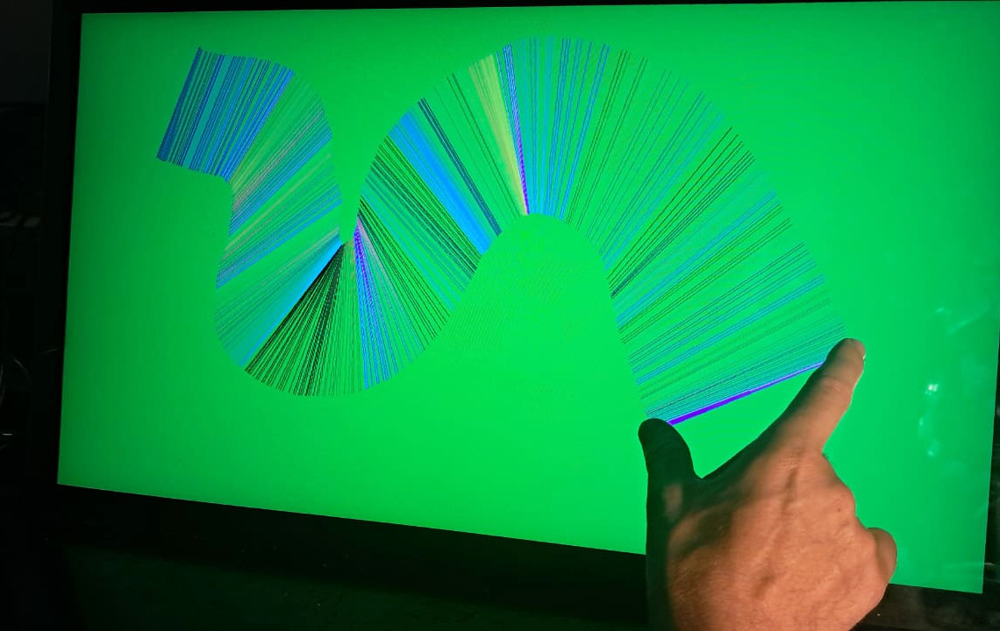
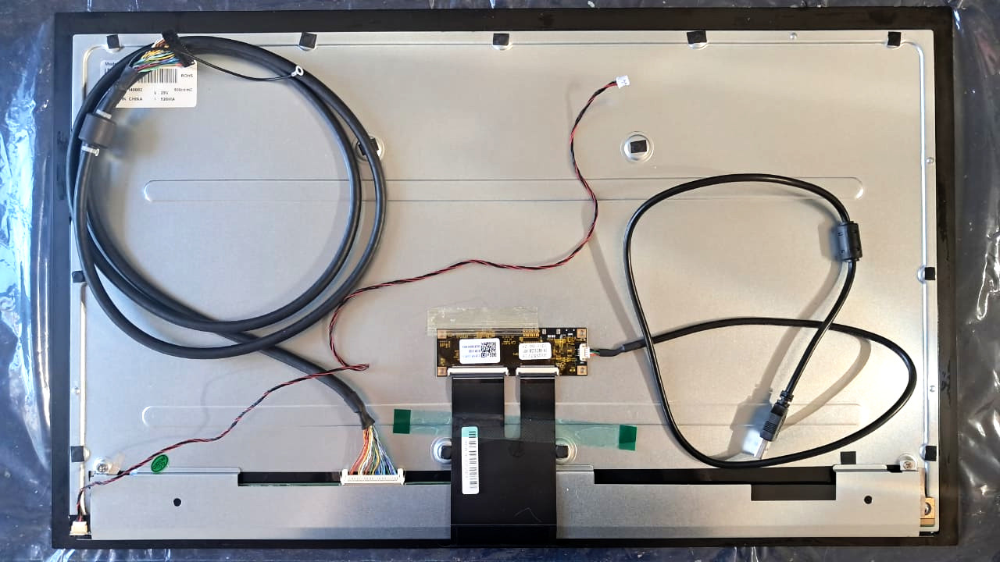
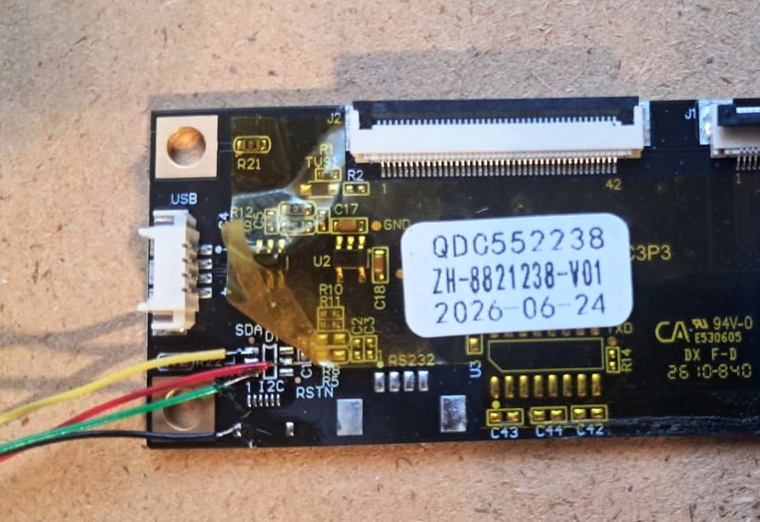

# Large display interactive demo

The test is carried on a 23.8" 1920x1080 high brigthness touch display (dual channel LVDS interface).  
It runs a [micropython script](./micropython/large_display_demo.py) which draws lines of different colors when two simultaneous touches are detected.  

</img>

## Display details

The display integrates a touch controller board (at the center), is provided with a 1 meter long dual channel LVDS cable attached to a 51-pin connector (bottom left) and a high-voltage led string power input (left corner) to be driven by a high power backlight driver. The display is cased with a sturdy metal sheet and plastics at the sides.  



## Touch panel control
A ICL2510P.C3.P3.V1 board is used to control the optically bonded touch panel.  

The data can be accessed y USB or by I2C. USB is avoided since add too much complexity for interfacing with the main board. I2C is easier but the touch controller board lacks the connector (it is unpopulated), and pinout is:
```
1.VDD
2.GND
3.SDA
4.SCL
5.INT
6.RST
```

Besides the missing 6-pin FPC connector could be added, the pinout does not match the one of the passive [LVDS board 2ch-8bit board](../hardware/LVDS_adapter), so direct wiring was used.  

</img>
  

The touch board doesn't populate pullups required by  I2C, so the setup can rely on the pullups provided by the main boar, or alternatively you might use internal pullups (i.e. "PULLMODE=UP" attrribute for  ECP5 FPGA devices, but they may be weak).

It was noted that the power pin at the I2C connector (pin 1, VDD ) does not work, so 5V was supplied at the USB pins. With that solved and the pullups added, the device was detected at the I2C bus (expected address is 0x41, so 65 decimal):

```
>>> i2c.scan()
[65]
```
The touches are correctly reported, see [i2c_touch_test.py](micropython/i2c_touch_test.py) which was updated to  suppport both the ILI2511 and the ILI2510. Once executed the python console shows:  
```
ID 0 at ( 119 , 5046 )
ID 1 at ( 1 , 5402 )
ID 2 release
ID 3 release
ID 4 release
ID 5 release
```

Note that the maximum reported values are 16384-1 for the rightmost touch along the horizontal, and 9600-1 in regards to the vertical axis.

