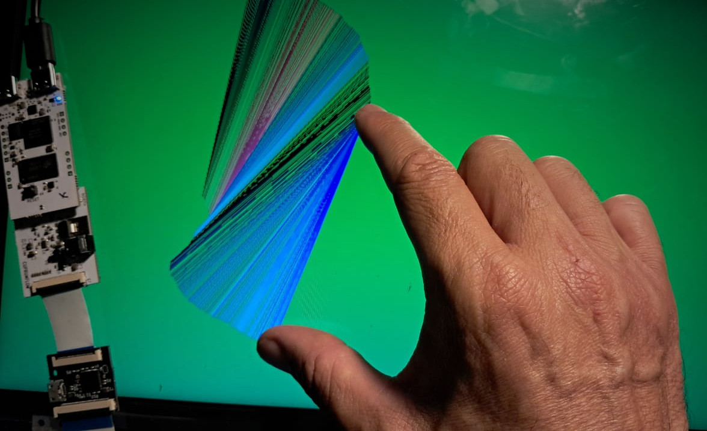

# Micropyhon demos

## Interactive demo

This demo shows an integrated interactive aplication, based on a eDP display connected to the main board using as intermediate the [LVDS to eDP adapter board](../../hardware/eDP_adapter/README.md), and an the [USB HID bridge board](../../hardware/Touch_splitter/README.md) for extrating touch data.

</img>

The application is written in micropython, see [touch_and_draw_test.py](touch_and_draw_test.py).  
It needs the eDP adapter be previously configured by I2C using the [i2c_it6251_test.py](i2c_it6251_test.py) script.

This is a full integration demo project. As seen, many boards are involved: the FPGA main board with the required adapter, plus an extra board to access the touch data, controlled by the software: scripts running in the [micropython port](../../micropython/ports/litex) to the SoC platform.

