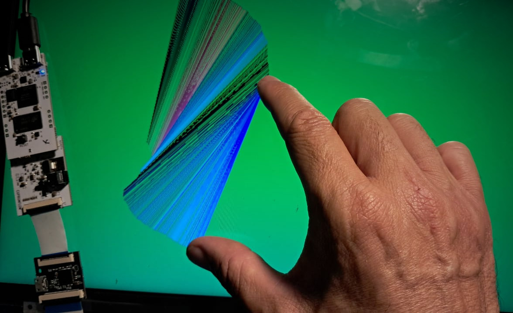
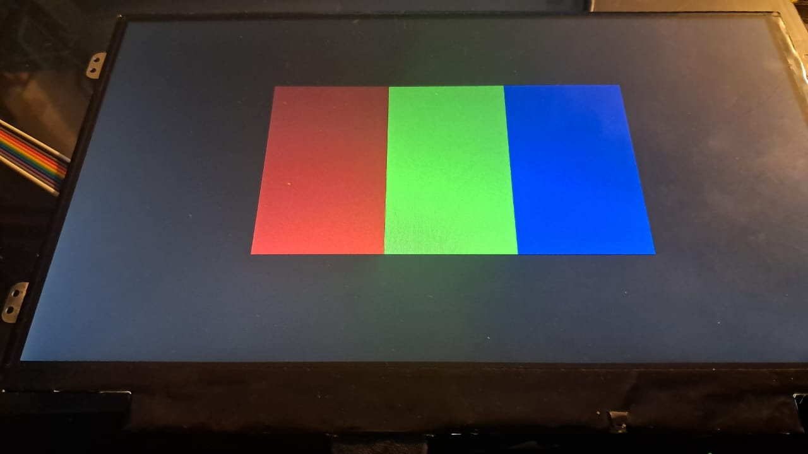

# Micropython demos

## Interactive demo

This demo shows an integrated interactive aplication, based on a eDP display (1366x768) connected to the main board using as intermediate the [LVDS to eDP adapter board](../../hardware/eDP_adapter/README.md), and an the [USB HID bridge board](../../hardware/Touch_splitter/README.md) for extrating touch data.

</img>

The application is written in micropython, see [touch_and_draw_test.py](touch_and_draw_test.py).  
It needs the eDP adapter be previously configured by I2C using the [i2c_it6251_test.py](i2c_it6251_test.py) script.

This is a full integration demo project. As seen, many boards are involved: the FPGA main board with the required adapter, plus an extra board to access the touch data, controlled by the software: scripts running in the [micropython port](../../micropython) to the FPGA platform.

## RGB565 modes

The framebuffer can be set in 16-bit color mode (RGB565 format) to halve memory bandwidth or duplicate framerate. It was tested on a 10.1" LVDS 1366x768 display using this [test script](framebuf_rgb565.py).  
  
</img>

See the [changes](https://github.com/openconcepts-ar/accel2d/commit/c02795d3175d810f2537590d0ec2b514abff1690) required to support HD resolution in the SOC (16-bit or 32-bit color mode), and the [new PHY](https://github.com/openconcepts-ar/accel2d/blob/pcbfixes1/openldi.py) to control OpenLDI-based (a.k.a. LVDS) displays, which implements a 7-to-1 serializer.

## Double buffer test

This [demo](framebuf_doublebuffer_test.py) implements the double buffer technique to avoid tearing, which is produced when you update the frame being sent to the display: it may show partial updates. The technique consists in drawing in a non-visible buffer, and when is ready, swith to it. Then you draw in the other buffer in a ping-pong fashion.

This demo draws a clock hand mimicking the second hand, advacing once per frame so it completes a complete turn at 60hz frame rate and half at 30Hz rate. This way you can se the tearing avoidance and also the actual frame rate.

