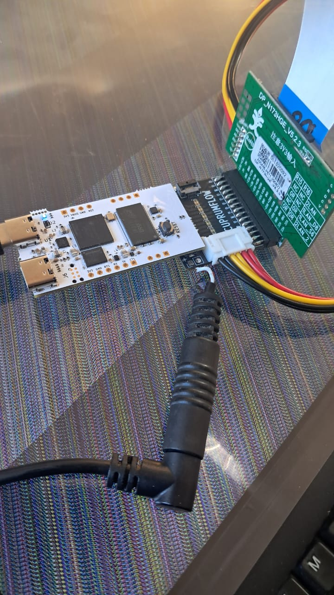
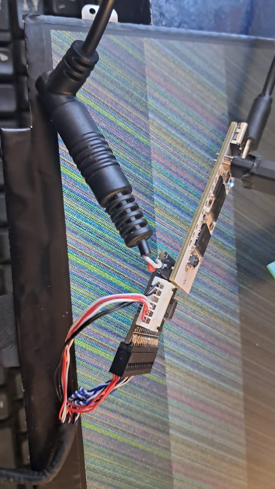
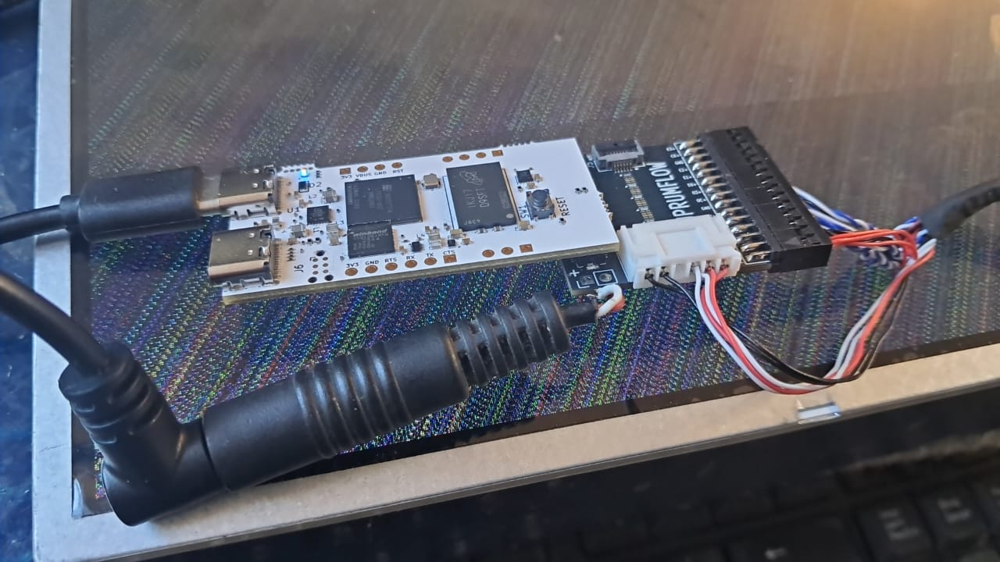

## LVDS Adapter 2ch 8-bit with no DC-DC

Tested with the FPGA board and a COTS LVDS to eDP adapter DP_N173HGE (jumper set for 3.3V supply).  
  
BUG FOUND: **the LCD 6-pin power connector had the pins inverted**, providing negative supply to the display. It was solved temporarily by inverting the connection to the 2-pin heeader for external backlight supply.  

It was discovered that the 1366x768 touch enabled display backlight works from 4.5V.

## LVDS without eDP
  
13.3" and 15.6" tested, also the backlight works down to 4.5V.

  
  
