# Tested displays

The system was tested with the following displays (HD and FHD except a 1600x900 one). Largest display is 23.8" (FHD), smallest 10.1".

- 10.1" 1366x768 LVDS FPC interface, 6 bit color.
- 12.5" 1366x768 LVDS FPC interface, IPS, 6 bit color.
- 13.3" industrial monitor using analog VGA signals (1920x1080 native resolution).
- 14.0" 1600x900 LVDS (dual channel) FPC interface, 6 bit color.
- 15.6" 1920x1080, IPS, eDP interface (50Hz refresh).
- 15.6" 1366x768 LVDS FPC interface, 6 bit color.
- 15.6" 1366x768 LVDS eDP interface, 6 bit color, with touch.
- 21.5" monitor using digital and analog signals (1920x1080 native resolution).
- 23.8" 1920x1080, IPS, LVDS (dual channel) FPC interface, 8 bit color, with touch.

See the corresponding pictures below.  
  

## Laptop displays
Those are direct connected using a 0.5mm pitch flat cable carrying eDP or LVDS signals (30 and 40 pin, respectively)  
Tested with the FPGA board (ECP5 version).  

|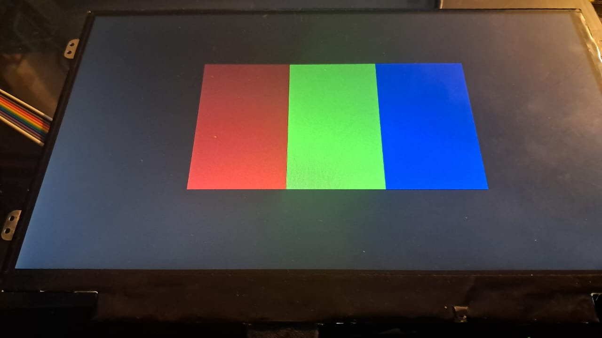</img>|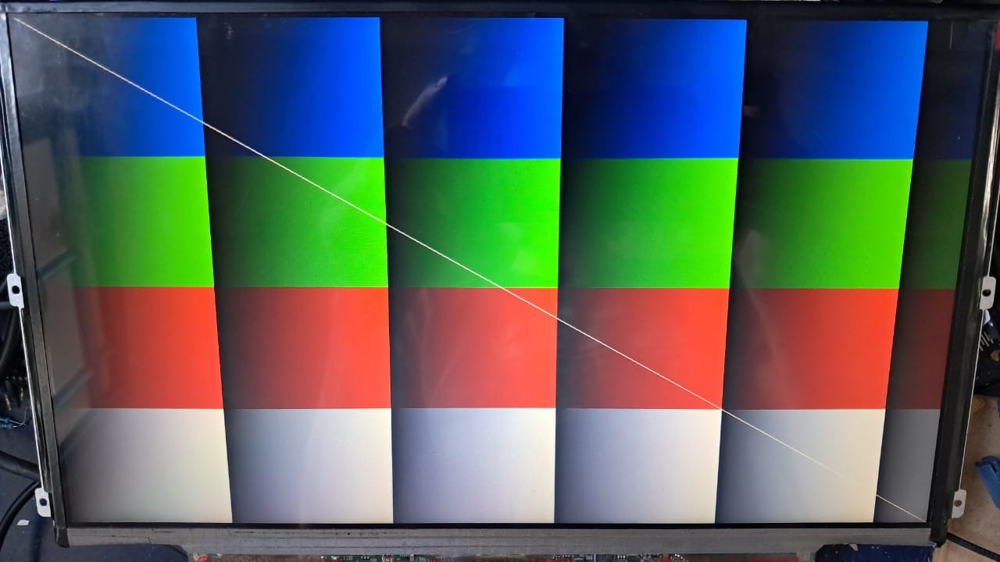</img>|
|:--:|:--:|
| *10.1" 1366x768 LVDS (single channel)* | *12.5" 1366x768 LVDS IPS* |
  
|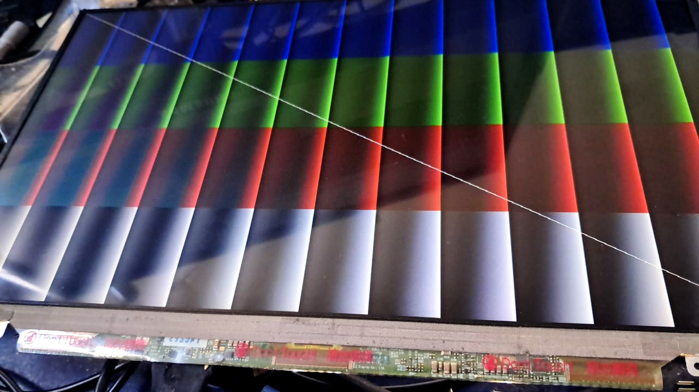</img>|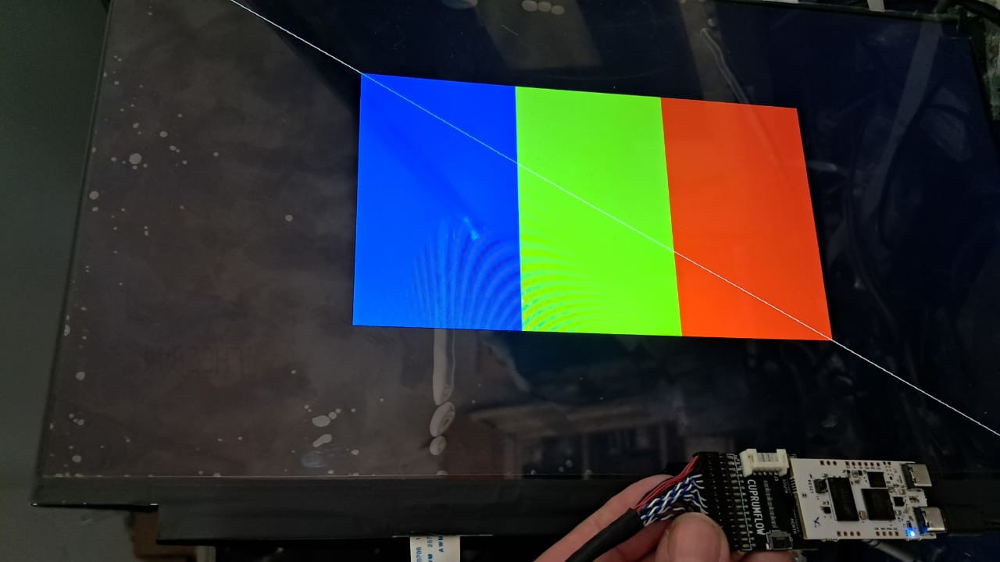</img>|
|:--:|:--:|
| *14" 1600x900 LVDS (dual channel)* | 15.6" 1920x1080 eDP IPS (same odd/even pixels)* |
  
|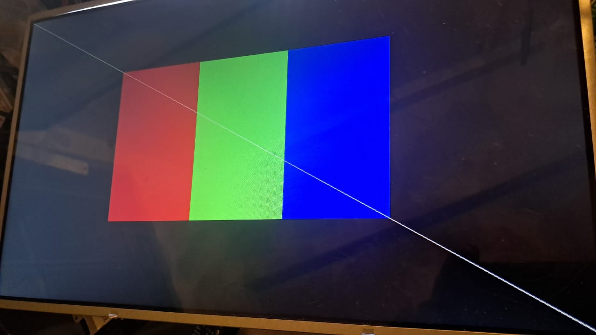</img>|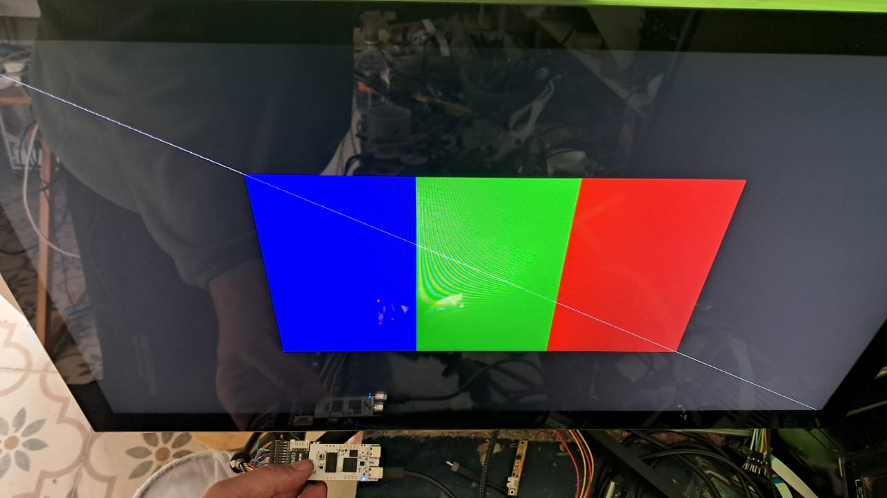</img>|
|:--:|:--:|
| *15.6" 1366x768 LVDS (single channel)* | *23.8" 1920x1080 LVDS (dual channel, same odd/even pixels)* |
  
|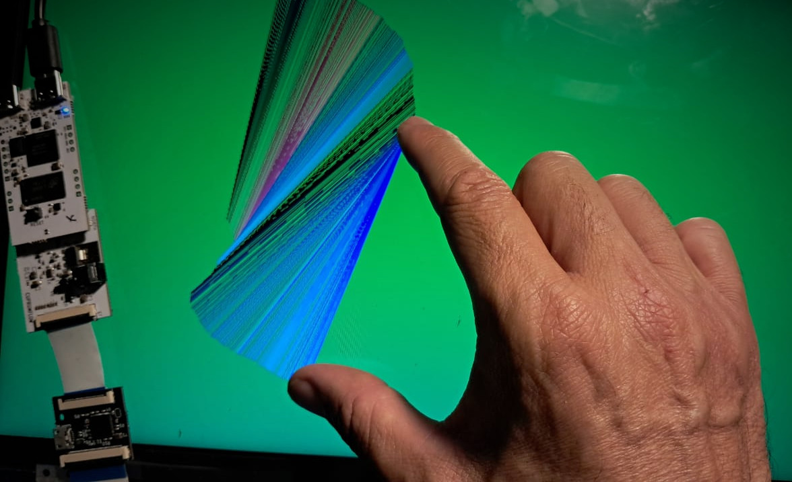</img>|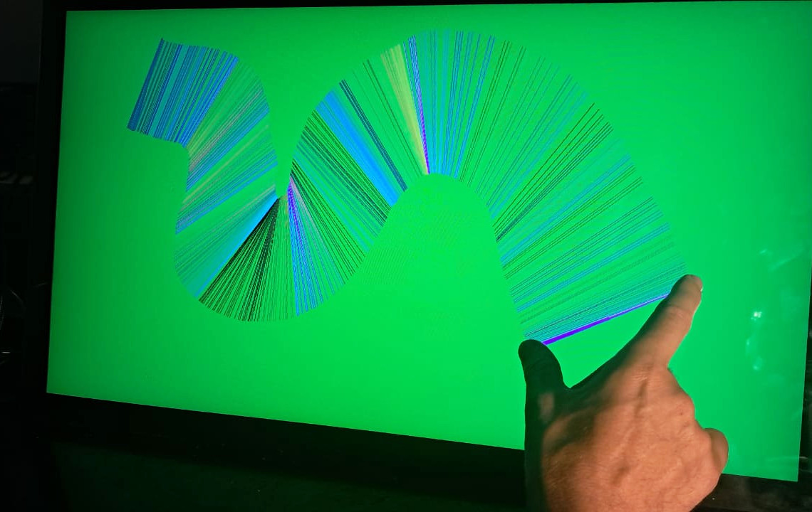</img>|
|:--:|:--:|
| *15.6" 1366x768 eDP with touch* | *23.8" LVDS dual-channel, with touch* |

## PC compatible monitors 
Standard analog or digital inputs (VGA or HDMI capable monitors).  
Tested with the CPU board.  

|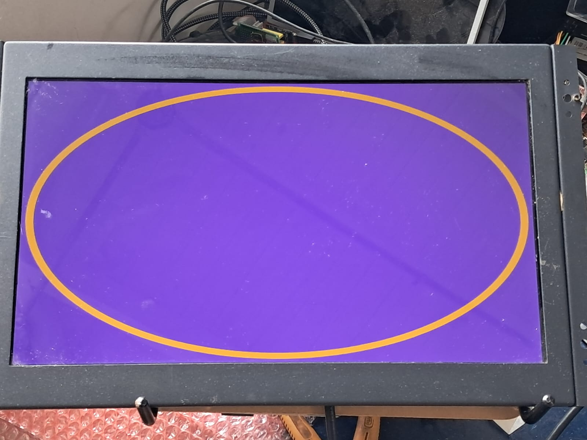</img>|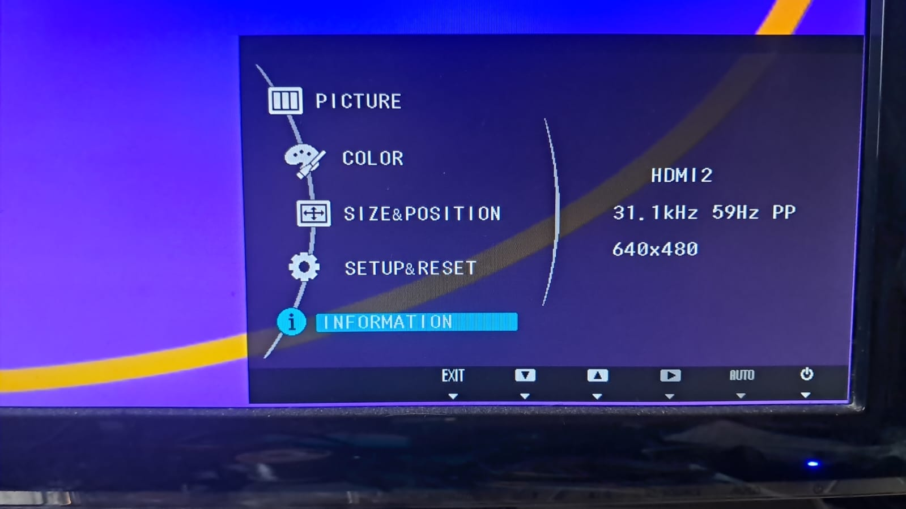</img>|
|:--:|:--:|
| *13.3" industrial monitor using 480p VGA (analog) signals* | *21.5" monitor using 480p DVI (digital) signals* |
  
|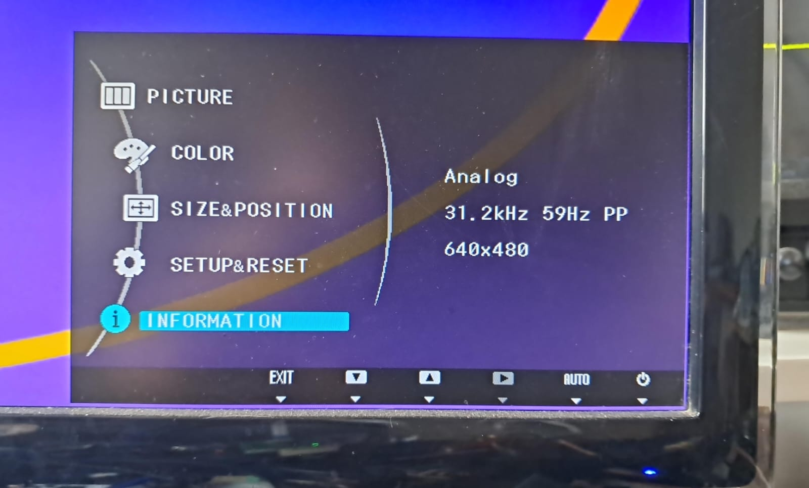</img>|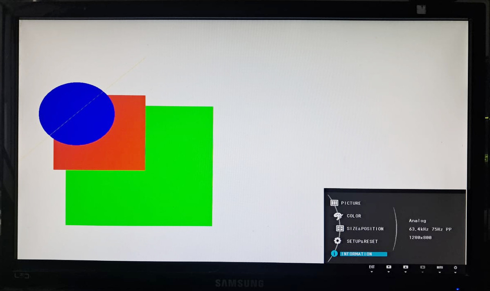</img>|
|:--:|:--:|
| *21.5" monitor using 480p VGA (analog) signals* | *21.5" monitor using VGA (analog) signals, HD resolution* |

|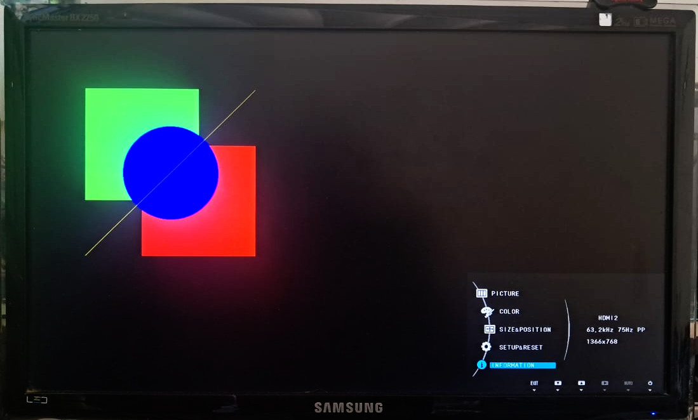</
|:--:|
| *21.5" monitor using DVI (digital) signals, HD resolution* |
