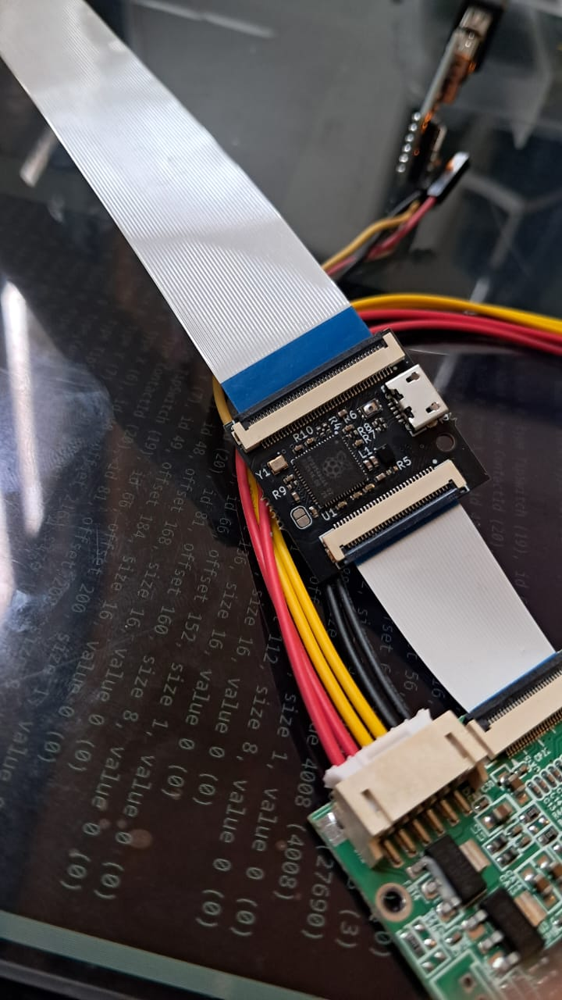

# USB Touch adapter eDP USBHOST v0.1

The current design, based on the active oscillator YE12MUBCE2O to avoid crystals and capacitors -at just 2.0x1.6mm-proved to be good, saving board space.  
The polarized inductor is as small works too
The board needs external 3.3V power (note that a display controller CAN CUT POWER if a display is not detected or for standby). This may imply that  the touch sensor may take power from the display power or independently (so it is possible that the touch panel works without powering the image display).  

## Build and firmware loading
Build all projects, then:
```
cd examples
mkdir -p build && cd build
export PICO_SDK_PATH=/path/to/pico-sdk/ #point to your location
cmake -DPICO_BOARD=pico2 .. #or BOARD=pico for RP2040
make -j
```
Now upload the firmware:
```
cp host_hid_to_uart/host_hid_to_uart.uf2 /media/$USER/RP2350 #or where the USB MSC gets mounted
```
TX pin is GPIO20 (TP2), RX is GPIO21 (TP3), INT is GPIO19 (TP4). The panel under test is specified to receive 5V the supply but it worked at 3.3V.  

## Board testing



Example receiving the multitouch data on a PC:
```
13292ms: Magic 03 EVENT type 02, addr 01, instance 00, [2a94:5009] payload len 0040:
report 0, block 0, type TipSwitch (19), id 66, offset 8, size 1, value 1 (-1)
report 0, block 0, type ContactId (20), id 81, offset 16, size 8, value 0 (0)
report 0, block 0, type X (6), id 48, offset 24, size 16, value 126 (126)
report 0, block 0, type Y (7), id 49, offset 40, size 16, value 152 (152)
```

## Test results

Tested at HD and FHD.
No signal integrity problems or issues of other kind found.
The non-standard pin 24 and 25 on the 30-pin eDP connector dont interfere with video signals either.


