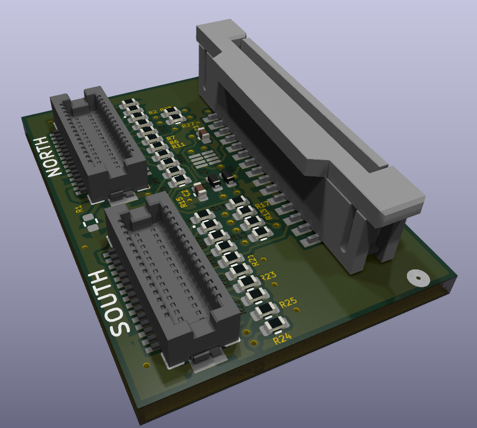
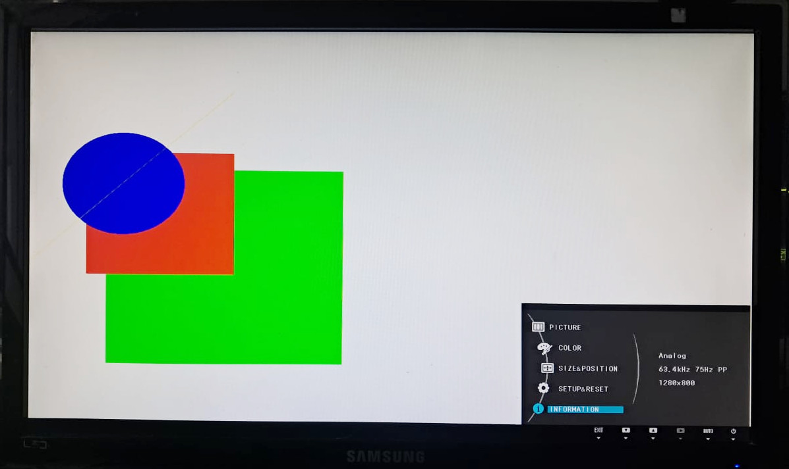

# Analog VGA adapter

## High resolution support

See the [high resolution demo](https://github.com/suarezvictor/micropython/commit/24a22f3e9bb7a56ed9656c2804c5f700707f7d8c) and the corresponding support on the video driver whcih also allows to [set correct polarity selection of the DE pin](https://github.com/openconcepts-ar/accel2d/commit/398651c1404b2dbd77ca0be4c95cb8b61d8ad678#diff-7008559ce1d50649cbed555c62c4800156974064933927117472b5cdf1626022R489) (data enable signal).  

The inverted DE polarity is required by the eplaced transitors (incorrect PMOS, now corrected NMOS): a high signal in the DE pin clapms the analog signal. So it is now possible to show non-black signals up to the rightmost pixel, avoiding the [VGA black reference issue](https://github.com/litex-hub/litevideo/issues/42) but for the CPU platform instead of FPGA.

</img>
