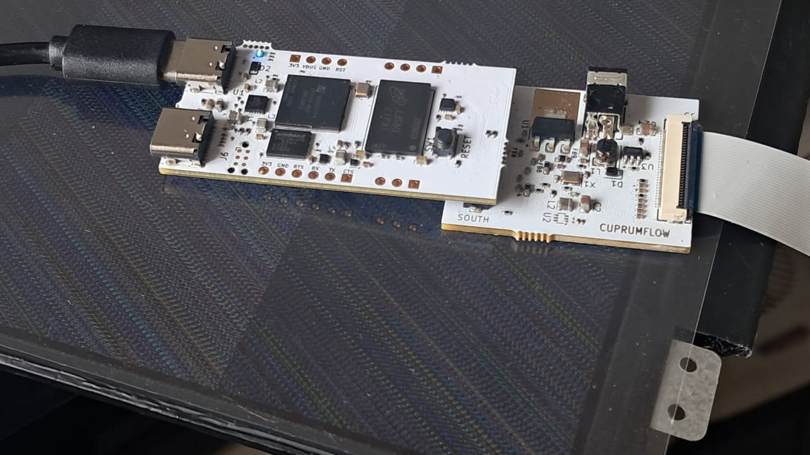

# LVDS to eDP

## Build
In a first terminal:
```
$ python3 ./gsd_orangecrab.py --with-gpio --pixel-bus-width=32 --timer-uptime --cpu-type=vexriscv --uart-baudrate 921600 --sys-clk-freq 75e6
```

In a second terminal:
```
$ cd micropython/ports/litex
$ make BUILD_DIRECTORY=../../../build/gsd_orangecrab #make sure riscv gcc is in PATH
$ litex_term /dev/ttyUSB1 --speed 921600 --kernel=build/firmware.bin
```
This wll launch micropython REPL when bitstream is loaded (use first terminal):

```
$ openFPGALoader -c ft2232 build/gsd_orangecrab/gateware/gsd_orangecrab.bit
```

## Board based on ITE chip

</img>

First terminal:
```
$ python3 micropython/tools/pyboard.py -d /dev/ttyUSB1 -b 921600 demos/micropython/i2c_it6251_test.py
```
(Or paste in the micropython REPL with Ctrl-E if script size is an issue)  
This activates the LVDS to eDP conversion and produces at the console:

```
Screen size: 34 x 19cm
Native resolutions:
	1366 x  768	71.1 MHz pixel clock
	1366 x  768	60.2 MHz pixel clock
reg0E = 90, Link Rate = HBR
reg0D = 3e,  HPD Video Stable
frequency = 34302729, xCnt = 806
Data Enable start: (71, 8)
The following is the current Modeline, not from EDID:
Modeline "1366x768@30_0" 34.303 1366 1400 1432 1469 768 772 774 778 +HSync +VSync
```
  
**Which is a truly correct modeline deduced from actual register values of the ITE chip.**

## Smoke test
Step up for backlight outputs about 12V (both under load or if not loaded).  
LDO 1.8V works.  
**ISSUE***: Yhe DC-DC for 3.3V display supply outputs 1.2V since incorrect 100K/100K divider. Corrected by disabling the DC-DC and taking 3.3V from the main board (using the jumper for that purpose, but this is **not recommended** since extra load can influence the main board 3.3V supply and may make DRAM to not pass checks).  
**AUX has polarity inverted** but it was fixed manually on a 40-to-30 eDP adapter.   
As shown above, the I2C communication works (tested with the FPGA board)  

## Board based on NCS chip

Smoke test: do same fixes as in the ITE board
Step up for backlight outputs about 12V (no load). LDO for 1.2V is also ok. 
The I2C communication works (tested with the FPGA board)  
